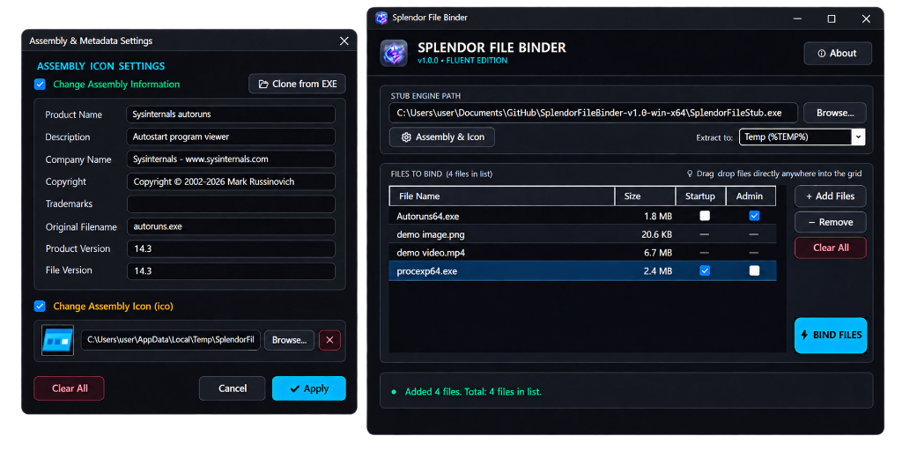

<div align="center">


# Splendor File Binder

**Combine multiple files, scripts, and executables into a single standalone `.exe` with a modern Fluent Dark Windows UI.**

[](https://github.com/Clonotril/Splendor-File-Binder/releases)
[](https://github.com/Clonotril/Splendor-File-Binder/releases)
[](https://dotnet.microsoft.com/)
[](LICENSE)

[Download Latest Release](https://github.com/Clonotril/Splendor-File-Binder/releases/latest) • [Usage Guide](#usage-guide) • [Demo Video](assets/demo_video.mp4) • [Build from Source](BUILDING.md) • [Report Issue](https://github.com/Clonotril/Splendor-File-Binder/issues)

</div>

---

## Preview



## 🎬 Demo Video

https://github.com/user-attachments/assets/f307c7c6-e28c-4a29-a3ca-698802213ee2


---

## Features

- **Modern Fluent Dark UI (`v1.0.0`)** — Custom dark title bar, rounded `FluentCard` containers, `FluentTextBox` inputs, hover-highlighted `FluentButton` controls, and smooth progress indicator.
- **Drag & Drop Support** — Drag files directly anywhere onto the window or the file grid (duplicate files are automatically skipped).
- **Bind Any File Type** — Package executables, scripts, installers, documents, images, or videos into one self-extracting `.exe`.
- **Per-File `Startup` & `Admin` Toggles** — Enable Windows Startup registration or UAC elevation (`Run as Admin`) individually per file, with hover tooltips on column headers and automatic file-type validation:
  - **Startup supported:** `.exe`, `.com`, `.scr`, `.bat`, `.cmd`, `.vbs`, `.js`, `.wsf`, `.ps1`, `.lnk`
  - **Run as Admin supported:** `.exe`, `.com`, `.scr`, `.msi`, `.bat`, `.cmd`, `.vbs`, `.js`, `.wsf`, `.ps1`, `.reg`, `.cpl`
- **Clone Metadata & Multi-Resolution Icon from EXE** — Open **Assembly & Icon**, click **Clone from EXE**, and automatically import Product Name, Description, Company, Copyright, Versions, and the full multi-resolution `.ico` from any existing executable.
- **Configurable Extract Location** — Choose where embedded files extract on launch (`%TEMP%`, `%APPDATA%`, Current Directory, or `%PROGRAMDATA%`).
- **Fully Self-Contained Output** — Both the Binder GUI and generated bound executables run standalone on Windows x64 with **zero `.NET` runtime installation required**.
- **Built-in About Dialog** — Click `ⓘ About` in the header for version info, clickable repository/guide links, disclaimer, and full MIT license text.

---

## Download & Installation

1. Go to the [**Releases**](https://github.com/Clonotril/Splendor-File-Binder/releases/latest) page and download **`SplendorFileBinder-v1.0-win-x64.zip`**.
2. Extract **all files** from the `.zip` archive into a folder of your choice.
3. Verify these 4 files are kept together in the same directory:

   | File | Purpose |
   |------|---------|
   | `SplendorFileBinder.exe` | Main Fluent Dark GUI application (double-click to run) |
   | `SplendorFileStub.exe` | Standalone runner stub embedded into bound executables *(auto-detected)* |
   | `rcedit.exe` | PE resource editor for injecting icons & assembly metadata *(auto-detected)* |
   | `app.ico` | Application icon rendered in the GUI header and About dialog |

4. Double-click **`SplendorFileBinder.exe`** to launch. No installer or `.NET` download is required.

> **Important:** Keep `SplendorFileStub.exe` and `rcedit.exe` in the same folder as `SplendorFileBinder.exe` so the Binder detects them automatically on startup.

---

## Usage Guide

1. **Verify Stub Path** — `SplendorFileStub.exe` is filled in automatically if it sits next to `SplendorFileBinder.exe`. If it's elsewhere, click **Browse...** to select it.
2. **Choose Extract Location** — Select where the bound executable will unpack its embedded files when launched:

   | Option | Extract Path | Auto-Cleanup |
   |--------|--------------|--------------|
   | **Temp (%TEMP%)** *(default)* | `%TEMP%\SplendorFileBinder\<id>` | Yes (cleans up after launch) |
   | **AppData (%APPDATA%)** | `%APPDATA%\SplendorFileBinder\<id>` | No |
   | **Current Directory** | `<exe dir>\SplendorFileBinder_<id>` | No |
   | **ProgramData (Admin)** | `%PROGRAMDATA%\SplendorFileBinder\<id>` | No |

3. **Configure Assembly & Icon *(optional)*** — Click **⚙ Assembly & Icon** to:
   - Customize metadata fields (`Product Name`, `Description`, `Company Name`, `Copyright`, `Trademarks`, `Original Filename`, `Product Version`, `File Version`).
   - Pick a custom `.ico` file for the output `.exe`.
   - Or click **📂 Clone from EXE** to copy all metadata and extract the icon from any existing `.exe` in one step.
4. **Add Files** — Click **+ Add Files** or **drag & drop files** directly into the grid.
5. **Toggle Per-File Options** — Check **Startup** (copies file to the Windows Startup folder on first run) or **Admin** (prompts UAC elevation for that file). Unsupported file types display `—`. Hover over the **Startup** or **Admin** column header anytime for a quick reminder.
6. **Bind** — Click **⚡ BIND FILES**, choose an output filename (e.g. `MyPackage.exe`), and wait for completion.
7. **Test** — Run your generated `.exe` to confirm all embedded files extract and launch as configured.

---

## How It Works

Splendor File Binder uses a **stub + ZIP payload** architecture (similar to self-extracting SFX archives):

```
┌──────────────────────────────────────────────────────────┐
│  Output .exe Layout                                      │
├──────────────────────────────────────────────────────────┤
│  SplendorFileStub.exe bytes   (PE + .NET single-file)    │
│  ─────────────────────────────────────────────           │
│  ZIP archive              (bound files + manifest JSON)  │
│  ─────────────────────────────────────────────           │
│  8 bytes: ZIP offset      (where the ZIP starts)         │
│  8 bytes: magic marker    ("SPLNDBND")                   │
└──────────────────────────────────────────────────────────┘
```

1. **Building the Output EXE (`BinderEngine` + `IconInjector`):**
   - Copies `SplendorFileStub.exe` to a temporary file.
   - If custom icon or assembly info is enabled, splits the `.NET` single-file PE from its bundle overlay, applies PE resources with `rcedit.exe`, and reassembles the bundle with fixed header offsets so the `.NET` runtime stays valid.
   - Appends a ZIP archive containing all payload files and `__splendor_manifest.json`, followed by the 8-byte ZIP offset and `"SPLNDBND"` magic marker.
2. **Executing the Output EXE (`Stub.Program`):**
   - Reads itself from disk, locates `"SPLNDBND"`, extracts the ZIP archive to the configured target folder, copies any `startupFiles` into the Windows Startup folder, and launches each extracted file (`Verb = "runas"` for `adminFiles`).

---

## Project Structure

```text
Splendor-File-Binder/
├── SplendorFileBinder.slnx          # Visual Studio / .NET solution
├── BUILDING.md                      # Step-by-step PowerShell build & release guide
├── LICENSE                          # MIT License
├── README.md                        # Documentation
├── app.ico                          # Active transparent rounded-tile icon
├── app-rounded.ico                  # Rounded-tile icon variant
├── app-crystal.ico                  # Background-free floating crystal icon variant
├── assets/
│   ├── screenshot.png               # UI & Assembly Settings preview
│   └── demo_video.mp4               # End-to-end walkthrough video
├── src/
│   ├── Binder/                      # WinForms GUI (.NET 10 Windows)
│   │   ├── Binder.csproj
│   │   ├── Program.cs               # Entry point & fatal crash logger
│   │   ├── MainForm.cs              # Main window, drag-drop, grid, tooltips & bind flow
│   │   ├── AssemblySettingsForm.cs  # Metadata/icon editor & EXE cloner dialog
│   │   ├── AboutForm.cs             # About, guide links, disclaimer & MIT license dialog
│   │   ├── Theme.cs                 # Fluent Dark palette & custom controls
│   │   ├── BinderEngine.cs          # ZIP payload & stub assembly builder
│   │   ├── IconInjector.cs          # Single-file PE splitter, icon extractor & rcedit wrapper
│   │   └── app.ico                  # Embedded application icon
│   └── Stub/                        # Self-contained trimmed runner (.NET 10)
│       ├── Stub.csproj
│       └── Program.cs               # Payload extractor, startup registrar & launcher
└── tools/
    └── rcedit.exe                   # Electron rcedit (downloaded separately)
```

---

## Building from Source

### Prerequisites
- **Windows 10 / 11 (x64)**
- **.NET 10 SDK** — [Download](https://dotnet.microsoft.com/download)
- **`rcedit.exe`** — Place in `tools\rcedit.exe` ([Download from electron/rcedit](https://github.com/electron/rcedit/releases))

### Quick Release Build (PowerShell)

Run these commands from the repository root (see [**BUILDING.md**](BUILDING.md) for full details and troubleshooting):

```powershell
# 1. Publish Stub (self-contained, trimmed, single-file)
dotnet publish src\Stub\Stub.csproj -c Release -r win-x64 --self-contained true -p:PublishSingleFile=true -p:PublishTrimmed=true -o publish\Stub

# 2. Publish Binder GUI (self-contained, single-file)
dotnet publish src\Binder\Binder.csproj -c Release -r win-x64 --self-contained true -p:PublishSingleFile=true -p:IncludeNativeLibrariesForSelfExtract=true -o publish\Binder

# 3. Copy supporting files next to Binder
Copy-Item "publish\Stub\SplendorFileStub.exe" "publish\Binder\SplendorFileStub.exe" -Force
Copy-Item "tools\rcedit.exe" "publish\Binder\rcedit.exe" -Force
Copy-Item "app.ico" "publish\Binder\app.ico" -Force
```

> **Note:** Use PowerShell as shown above rather than `build.bat` (see [BUILDING.md](BUILDING.md#️-do-not-use-buildbat)).

---

## Disclaimer

> **Educational & Authorized Use Only**
>
> Splendor File Binder is provided strictly for educational purposes, legitimate software packaging, and authorized testing. Do not use this tool to distribute malware or perform unauthorized actions. The user assumes full responsibility for all generated executables.

## License

Released under the **MIT License** — see [LICENSE](LICENSE) for details.
Developed by **Ronxk** ([@Clonotril](https://github.com/Clonotril)).
